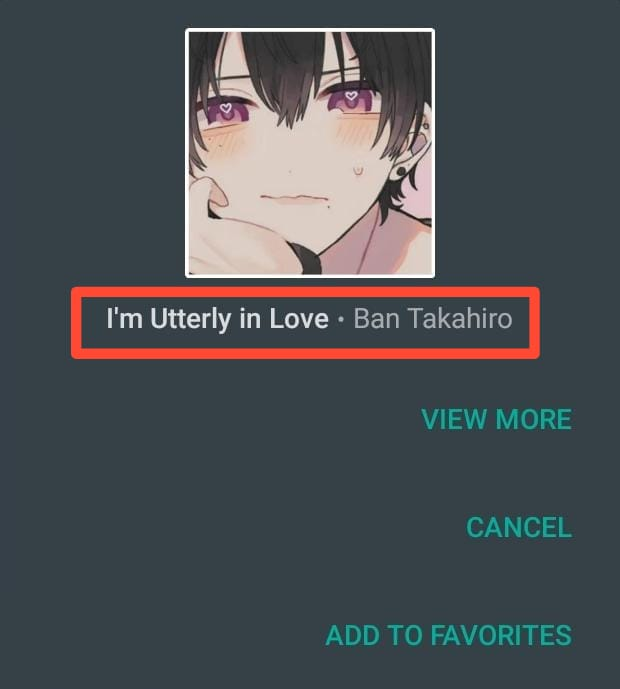

<div align="center">


# wa-sticker-formatter

Make WhatsApp stickers from images, GIFs and videos, with the pack name, author and emojis WhatsApp shows when someone taps the sticker.

[](https://www.npmjs.com/package/wa-sticker-formatter)
[](https://www.npmjs.com/package/wa-sticker-formatter)
[](https://github.com/AlenVelocity/wa-sticker-formatter/actions/workflows/ci.yml)
[](LICENSE)

</div>

```ts
import { Sticker, StickerTypes } from 'wa-sticker-formatter'

const sticker = new Sticker('./cat.mp4', { pack: 'My Pack', author: 'Me', type: StickerTypes.CROPPED })
await sticker.toFile('cat.webp')
```

It takes PNG, JPEG, WebP, GIF, AVIF, TIFF and SVG images, and MP4, WebM, MOV and MKV videos. The output is a WebP sized for WhatsApp (512x512, or smaller with the aspect ratio kept) and kept under 1 MB, so WhatsApp plays animated stickers. It works with [Baileys](https://github.com/WhiskeySockets/Baileys) and any other library that can send a WebP as a sticker.

## Install

```sh
npm install wa-sticker-formatter
```

- Node.js 20.9 or newer.
- Image processing uses [sharp](https://sharp.pixelplumbing.com), which installs prebuilt binaries for Windows, macOS and Linux (x64 and ARM64, glibc and musl/Alpine). Android/Termux needs one extra step, see [Troubleshooting](#troubleshooting).
- Stickers from **videos** need [ffmpeg](https://ffmpeg.org/download.html). Images and GIFs don't. Either install ffmpeg on the system (`apt install ffmpeg`, `brew install ffmpeg`, `winget install ffmpeg`, `pkg install ffmpeg` on Termux) or add it to your project with `npm install ffmpeg-static`.

## Usage

### With Baileys

`toMessage()` returns `{ sticker, isAnimated, width, height }`, which `sendMessage` accepts as-is. This replies to any image, GIF or video captioned `!sticker`:

```ts
import { downloadMediaMessage } from 'baileys'
import { Sticker, StickerTypes } from 'wa-sticker-formatter'

sock.ev.on('messages.upsert', async ({ messages }) => {
    for (const msg of messages) {
        const caption = msg.message?.imageMessage?.caption ?? msg.message?.videoMessage?.caption
        if (caption?.trim() !== '!sticker' || !msg.key.remoteJid) continue

        const media = await downloadMediaMessage(msg, 'buffer', {})
        const sticker = new Sticker(media, { pack: 'My Bot', author: 'Me', type: StickerTypes.FULL })
        await sock.sendMessage(msg.key.remoteJid, await sticker.toMessage(), { quoted: msg })
    }
})
```

`isAnimated` matters: Baileys doesn't detect it, and without it some WhatsApp clients won't play the animation.

### Input

The first argument can be:

- a `Buffer`, `Uint8Array` or `ArrayBuffer`
- a file path, or a `file://`, `http(s)://` or `data:` URL
- an SVG string (`'<svg ...>...</svg>'`)
- a readable stream or async iterable, such as the stream from Baileys' `downloadContentFromMessage()`

URLs are downloaded with `fetch`. If users of your bot can send URLs, check them first: the library downloads whatever it is given.

### Options

```ts
const sticker = new Sticker(input, {
    pack: 'My Pack', // pack name, shown in bold
    author: 'Me', // pack author
    type: StickerTypes.FULL, // how the input is fitted, see below
    categories: ['🤩', '🎉'], // emojis that describe the sticker
    id: '12345', // pack ID, random if omitted
    quality: 80, // WebP quality, 1-100
    background: '#000000', // fill colour for type 'full'
    maxSize: 1024 * 1024, // largest allowed sticker in bytes
    fps: 15, // frame rate for videos
    maxDuration: 10 // seconds of animation to keep
})
```

| Option                | Default                       | Notes                                                                                                                  |
| --------------------- | ----------------------------- | ---------------------------------------------------------------------------------------------------------------------- |
| `pack`                | `''`                          |                                                                                                                        |
| `author`              | `''`                          |                                                                                                                        |
| `type`                | `'default'`                   | See [sticker types](#sticker-types). Unknown values fall back to `'default'`.                                          |
| `categories`          | `[]`                          | Any emoji strings. [WhatsApp's docs](https://github.com/WhatsApp/stickers/wiki/Tag-your-stickers-with-Emojis)          |
| `id`                  | random 64-character hex       |                                                                                                                        |
| `quality`             | 100 (still), 80 (animated)    | The starting quality. It is lowered if the sticker is bigger than `maxSize`.                                         |
| `background`          | transparent                   | A CSS colour (`'#fff'`, `'white'`, `'rgba(0,0,0,0.5)'`) or `{ r, g, b, alpha }`. Only used by `full`.                  |
| `maxSize`             | 1 MB                          | Quality, then (for videos) frame rate, is reduced until the sticker fits. `0` turns this off.                          |
| `fps`                 | 15                            | Videos only. GIFs keep their own frame timing.                                                                         |
| `maxDuration`         | 10                            | Longer videos and GIFs are cut. 10 seconds is WhatsApp's limit.                                                        |
| `androidAppStoreLink` |                               | Google Play link of the app that made the sticker. Sticker-maker apps store this in their stickers.                    |
| `iosAppStoreLink`     |                               | App Store link of the app that made the sticker.                                                                       |

The same options can be set with chained setters:

```ts
const buffer = await new Sticker(input)
    .setPack('My Pack')
    .setAuthor('Me')
    .setType(StickerTypes.CIRCLE)
    .setCategories(['🤩'])
    .setId('12345')
    .setQuality(60)
    .setBackground('#000000')
    .build()
```

### Output

```ts
const buffer = await sticker.build() // WebP Buffer (toBuffer() is an alias)
const file = await sticker.toFile('sticker.webp') // defaults to ./<pack>-<author>.webp
const message = await sticker.toMessage() // { sticker, isAnimated, width, height } for Baileys

// Or in one call, with the same arguments as the constructor
const buffer2 = await createSticker(input, { pack: 'My Pack' })
```

## Sticker types

| Type                    | Value       | Result                                                                            |
| ----------------------- | ----------- | --------------------------------------------------------------------------------- |
| `StickerTypes.DEFAULT`  | `'default'` | Aspect ratio kept. Scaled down to fit 512x512 if larger, never scaled up.         |
| `StickerTypes.CROPPED`  | `'crop'`    | Cropped from the centre to 512x512.                                               |
| `StickerTypes.FULL`     | `'full'`    | Whole image fitted inside 512x512, the rest filled with `background`.             |
| `StickerTypes.CIRCLE`   | `'circle'`  | Cropped to 512x512 and cut into a circle.                                         |
| `StickerTypes.ROUNDED`  | `'rounded'` | Cropped to 512x512 with rounded corners.                                          |

All types work for still images, GIFs and videos.

## Size limits

WhatsApp's [sticker guidelines](https://github.com/WhatsApp/stickers/blob/main/Android/README.md) ask for 512x512 stickers of at most 100 KB (still) or 500 KB (animated), with animations up to 10 seconds. Stickers sent from a bot can be bigger, but WhatsApp may not play animated stickers over about 1 MB, which is why `maxSize` defaults to 1 MB. For stickers that follow the guidelines exactly, use `{ type: 'crop', maxSize: 500 * 1024 }`.

Fitting a long video into `maxSize` can take a few encodes. Lowering `maxDuration` or `fps` makes it faster and keeps the quality higher.

## Metadata

The pack name, author and emojis are stored as JSON in the WebP's EXIF data. When someone taps the sticker, WhatsApp shows the pack name in bold and the author below it:



### Reading metadata

```ts
import { extractMetadata } from 'wa-sticker-formatter'

const metadata = await extractMetadata(webpBuffer)
// { 'sticker-pack-id': '...', 'sticker-pack-name': 'My Pack', 'sticker-pack-publisher': 'Me', emojis: ['🎉'] }
```

It returns `{}` for a WebP without metadata, and also reads stickers made by other apps (Sticker.ly, Sticker Maker), including any extra keys they add.

### Only setting metadata

If you already have a WebP and only want to change its pack name and author, `Exif` writes the metadata without converting the image:

```ts
import { Exif } from 'wa-sticker-formatter'

const tagged = await new Exif({ pack: 'My Pack', author: 'Me' }).add(webpBuffer)
```

## ffmpeg

Videos are converted with ffmpeg. wa-sticker-formatter looks for it in this order:

1. a path set with `setFfmpegPath('/path/to/ffmpeg')`
2. the `FFMPEG_PATH` environment variable
3. the [`ffmpeg-static`](https://www.npmjs.com/package/ffmpeg-static) package, if installed
4. `ffmpeg` on your `PATH`

ffmpeg needs to be built with libwebp, which the usual packages are. Transparent VP9 WebM files, such as Telegram video stickers, keep their transparency when ffmpeg also has libvpx.

## Troubleshooting

**`Could not load the "sharp" module` / `Something went wrong installing the "sharp" module`**

Reinstall on the machine you run on: delete `node_modules` (and `package-lock.json` if it was created on another OS) and run `npm install` again. Copying `node_modules` between machines (from Windows to a Linux server, or from a Mac into a Docker image) gives you the wrong sharp binary. sharp's binaries are optional dependencies, so don't install with `--omit=optional` or `--no-optional`. sharp's [install guide](https://sharp.pixelplumbing.com/install) covers cross-platform installs.

**Termux (Android) and other platforms without a sharp binary**

Install sharp's WebAssembly build alongside it:

```sh
npm install sharp @img/sharp-wasm32
```

It is slower than the native build but works on any platform where Node.js runs.

**`illegal hardware instruction` or `Illegal instruction (core dumped)` on import**

sharp's prebuilt Linux x64 binary needs a CPU with SSE4.2 (most CPUs made since about 2010; some VPS and emulated CPUs don't report it). Use the WebAssembly build above.

**Two versions of sharp installed**

wa-sticker-formatter accepts sharp 0.34 and 0.35, so npm shares the copy Baileys or your own project already uses. Check with `npm ls sharp`. If an old sharp is still nested under `wa-sticker-formatter`, update both packages.

**`ffmpeg was not found`**

See [ffmpeg](#ffmpeg). Only video input needs it.

**Animated sticker is sent but doesn't play**

Use `toMessage()` with Baileys so `isAnimated` is set, and keep the default `maxSize` (or lower it).

**Telegram `.tgs` stickers**

These are Lottie vector animations and aren't supported. Render them to GIF or WebM first, for example with [lottie-converter](https://github.com/ed-asriyan/lottie-converter). Telegram's WebM video stickers and WebP stickers work directly.

**React Native, Expo or the browser**

Not supported. sharp and ffmpeg only run in Node.js, so do the conversion on a server.

## Upgrading from v4

- Node.js 20.9+ and sharp 0.34+ are required.
- The package ships ESM and CommonJS builds. `import` and `require` both work as before.
- `fluent-ffmpeg` (deprecated), `axios`, `file-type`, `fs-extra` and `image-size` are no longer dependencies.
- `type: 'default'` now scales images larger than 512x512 down instead of leaving them full size.
- Stickers are kept under `maxSize` (1 MB by default). Pass `maxSize: 0` for the old behaviour.
- Animated stickers start at quality 80 instead of 100 unless you set `quality`.
- `StickerTypes` is a plain object instead of a TypeScript enum. `StickerTypes.FULL` and `type: StickerTypes` work the same way.
- `toMessage()` also returns `isAnimated`, `width` and `height`.
- `Exif.add()` takes a Buffer, Uint8Array or file path, no longer a node-webpmux `Image`.

The full list is in the [changelog](CHANGELOG.md).

## Development

```sh
npm install
npm run build
npm test            # video tests are skipped if ffmpeg isn't installed
npm run check       # lint, format check, typecheck, build and test
npm run example -- ./some.gif   # writes one sticker of each type to examples/output/
```

[API documentation](https://alenvelocity.github.io/wa-sticker-formatter/)

## License

[MIT](LICENSE)
